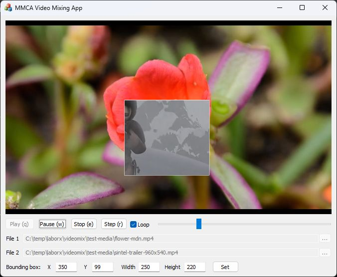
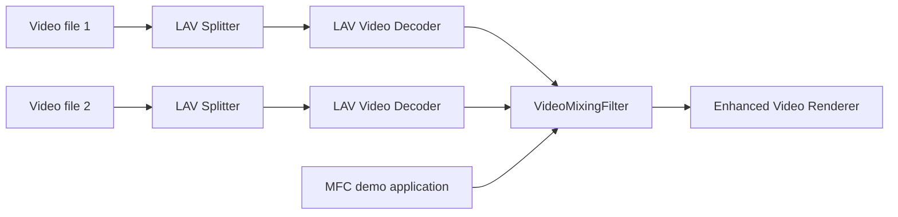

# VideoMix — two-stream DirectShow mixer

A Windows DirectShow project that combines two video streams into one output. The repository contains a custom mixing filter, an image source filter for the paused view, and an MFC demonstration application with playback and position controls. It also contains an older MSI installer.

## Running example

The screenshot shows `flower-mdn.mp4` as the background and `sintel-trailer-960x540.mp4` inside the outlined region. The application fields are X=350, Y=99, width=250, height=220 in the decoded video coordinate space. These are two different moving streams, not a still-image overlay.

The actual pixel composition is in [`VideoMixingFilter::GenerateOutputSample`](mixerfilter/VideoMixingFilter.cpp): it copies the first decoded frame to the output buffer, then calls [`DoBoundingBoxCompositeOverwrite`](mixerfilter/VideoMixingFilter.cpp) to copy pixels from the second frame inside the selected rectangle and draw its border. The rectangle can be changed with the four fields and **Set**, or by dragging it in the preview. [`sample/player.cpp`](sample/player.cpp) constructs and connects the two-input DirectShow graph; [`srcfilter/`](srcfilter/) contains the separate source filter for the paused-image view.

## Signal path

This diagram is reconstructed from `sample/player.cpp`; it is **not** a screenshot of a running DirectShow graph. The application also builds a separate paused-image graph using `srcfilter/VideoSourceFilter`.

## Source and build

- `mixerfilter/`: the two-input mixing filter and its interfaces.
- `srcfilter/`: image source filter used by the paused-image graph.
- `sample/`: MFC demonstration application.
- `VideoMixerInstaller/`: legacy installer project and prebuilt MSI.

The solution targets the Visual Studio 2010 `v100` toolset and Win32. Building it with a recent Visual Studio requires the **Desktop development with C++** workload, the MFC component, and adaptation of the old Windows SDK DirectShow BaseClasses dependency. The [Microsoft DirectShow BaseClasses sample](https://github.com/microsoft/Windows-classic-samples/tree/main/Samples/Win7Samples/multimedia/directshow/baseclasses) is a suitable source for that dependency. Third-party code and filters retain their respective upstream licenses and notices.

## Local verification (November 2026)

- Rebuilt DirectShow BaseClasses as a Win32 static library using Visual Studio 2022.
- Rebuilt the Win32 MFC application with the v143 toolset and MFC x86 component.
- Selected `sintel-trailer-960x540.mp4` and `flower-mdn.mp4` in the rebuilt application. The graph was created and the second video appeared inside the configured rectangle, as shown above. A second test used the same file for both inputs. The window remained responsive after playback and during a 25-second check with videos of different lengths.
- The rectangle defaults to X=0, Y=0, width=100, height=100. Its values are applied to each new graph, stay editable while the graph is running, and update after dragging the rectangle in the video window. The mixer's pixel buffer uses a bottom-left origin, so Y=0 draws the rectangle along the bottom edge.
- The keyboard shortcut handler now leaves keystrokes in the X/Y/Width/Height fields alone. Dragging in the video maps screen pixels to the video dimensions; clicking the empty playback area before a graph exists leaves the fields unchanged. The Set button rejects coordinates outside the video.
- The mixing filter releases frame buffers with `delete[]` and limits each pending-frame queue to four frames, avoiding unbounded memory use when one video ends before the other.
- Graph construction and playback steps are written to `VideoMixerApp-graph.log` beside the executable with their HRESULT values. On a build error, the dialog shows the failed step and HRESULT. Select the video files through the browse buttons so the graph is rebuilt.
- The application loads its bundled LAV Splitter, LAV Video Decoder, mixing filter, and paused-image source from its own directory. This avoids relying on per-user COM registration, which was not visible to one launched instance (`0x80040154`). The bundled `.ax` and `.dll` files must remain beside the executable.

The DirectShow connection code in `sample/player.cpp` explicitly uses `ConnectDirect` for the mixer's second input. This is an example of the low-level graph integration involved in the project.
