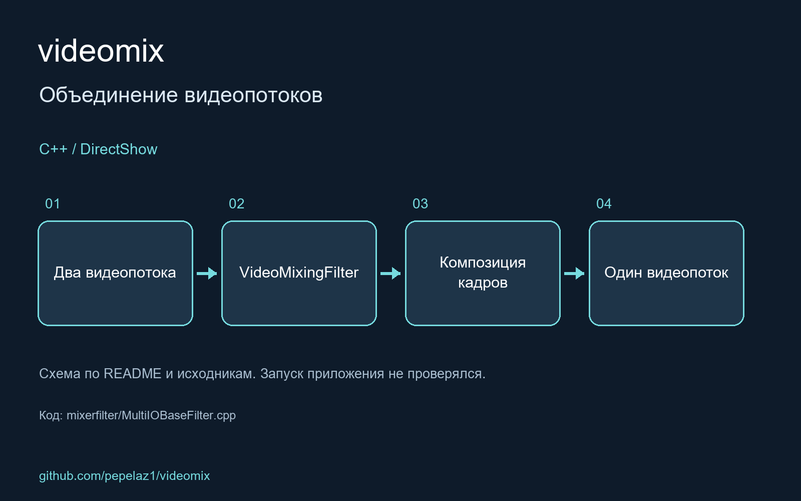

Custom DirectShow filter for composing 2 input video streams to a single output video stream

<!-- portfolio-visual:start -->
## Схема работы

Схема подготовлена по README и исходному коду. Запуск приложения не проверялся. Проект использует компоненты CSIR и LAVFilters; схема показывает архитектуру проекта вместе с зависимостями.
<!-- portfolio-visual:end -->
