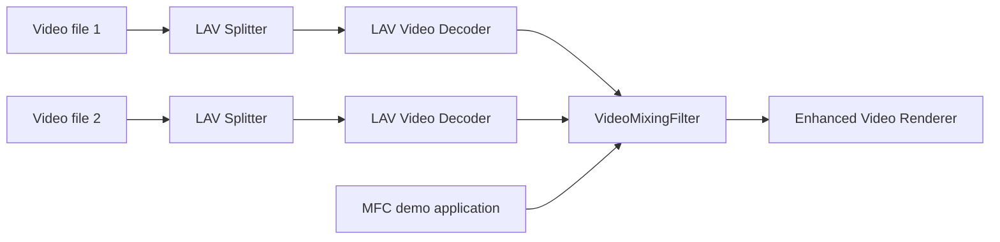

# VideoMix — two-stream DirectShow mixer

A Windows DirectShow project that combines two video streams into one output. The repository contains a custom mixing filter, an image source filter for the paused view, and an MFC demonstration application with playback and position controls. It also contains an older MSI installer.

## Signal path

This diagram is reconstructed from `sample/player.cpp`; it is **not** a screenshot of a running DirectShow graph. The application also builds a separate paused-image graph using `srcfilter/VideoSourceFilter`.

## Source and build

- `mixerfilter/`: the two-input mixing filter and its interfaces.
- `srcfilter/`: image source filter used by the paused-image graph.
- `sample/`: MFC demonstration application.
- `VideoMixerInstaller/`: legacy installer project and prebuilt MSI.

The solution targets the Visual Studio 2010 `v100` toolset and Win32. Building it with a recent Visual Studio requires the **Desktop development with C++** workload, the MFC component, and adaptation of the old Windows SDK DirectShow BaseClasses dependency. The [Microsoft DirectShow BaseClasses sample](https://github.com/microsoft/Windows-classic-samples/tree/main/Samples/Win7Samples/multimedia/directshow/baseclasses) is a suitable source for that dependency. Third-party code and filters retain their respective upstream licenses and notices.

## Local verification (November 2026)

- Rebuilt DirectShow BaseClasses as a Win32 static library using Visual Studio 2022.
- Started the prebuilt MFC demonstration application and selected two local MP4 samples.
- The application displayed **“Failed build graph”** before the missing `VideoSourceFilter.dll` was rebuilt. That filter and the mixer are now registered for the current user, but successful two-video playback has **not** been verified after registration. The legacy MFC project still needs a modern build.

The DirectShow connection code in `sample/player.cpp` explicitly uses `ConnectDirect` for the mixer's second input. This is an example of the low-level graph integration involved in the project.
